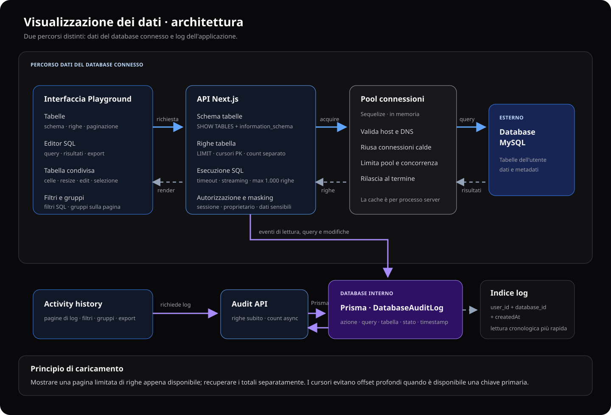
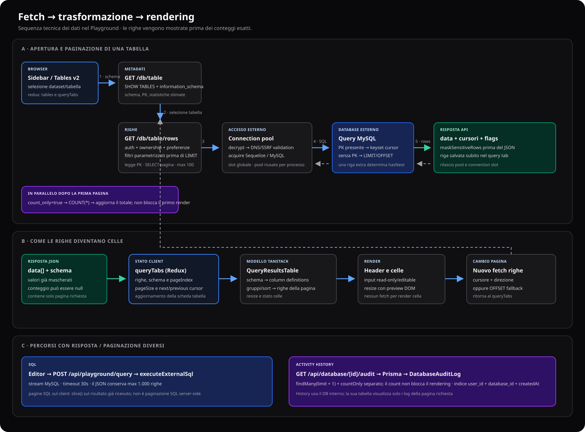
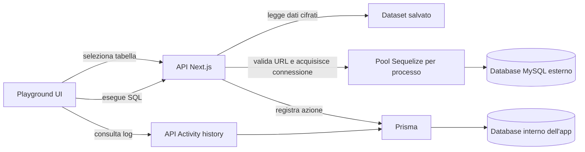
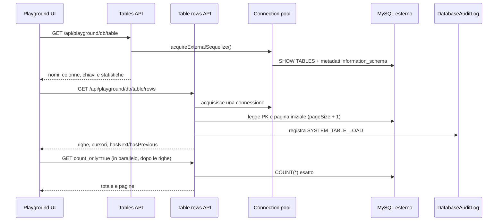

# Architettura e visualizzazione dei dati

Questo documento descrive il percorso dei dati nel Playground: dalla connessione al database salvato fino alla tabella mostrata nel browser. Copre le viste tabellari, le query SQL e l'Activity history.

## Flusso tecnico di fetch e rendering

## Mappa dei componenti

Il database esterno contiene i dati dell'utente. Il database interno dell'app contiene gli account, i dataset salvati, le preferenze e i log di Activity history. La History quindi non interroga il database esterno selezionato.

## Apertura di una tabella

L'interfaccia viene popolata appena arriva la prima pagina. Il conteggio esatto viene recuperato con una richiesta separata, così un `COUNT(*)` su una tabella grande non ritarda la visualizzazione iniziale. Le richieste di righe sono limitate a 100 per pagina.

Quando la tabella ha una chiave primaria, la paginazione usa un cursore cifrato basato sui valori della chiave: le pagine successive non devono saltare tutte le righe precedenti. Il cursore è legato al dataset e alla tabella. Se manca una chiave primaria, l'API ricade sulla paginazione `OFFSET`.

Il caricamento dello schema usa `SHOW TABLES` e interrogazioni aggregate a `information_schema`, evitando di fare una richiesta separata per ogni tabella o colonna. `TABLE_ROWS` è una stima fornita dal motore; non sostituisce il conteggio esatto delle righe.

## Esecuzione SQL

La scheda SQL invia la query a `POST /api/playground/query`. L'API:

1. verifica la sessione e che il dataset appartenga all'utente;
2. legge e decifra la stringa di connessione;
3. acquisisce una connessione dal pool;
4. registra query e azione in `DatabaseAuditLog`;
5. esegue la query e restituisce il risultato;
6. applica la mascheratura dei campi sensibili prima della risposta;
7. rilascia la connessione e completa il log.

I risultati SQL di tipo riga sono letti in streaming e la risposta conserva al massimo 1.000 righe. Per un `SELECT` diretto e per una CTE il cui comando principale è identificabile, l'API aggiunge un limite SQL di 1.001 righe se manca un `LIMIT`; un `LIMIT` numerico finale più alto viene ridotto. La riga in più permette di segnalare che il risultato è stato troncato. Solo i `SELECT` diretti ricevono anche l'hint MySQL `MAX_EXECUTION_TIME(30000)`. Query complesse che il parser prudenziale non riconosce non vengono riscritte: il timeout del driver resta il limite temporale, e la risposta conserva comunque al massimo 1.000 righe in memoria. La paginazione della scheda SQL divide in pagine lato interfaccia il risultato già ricevuto.

## Filtri, gruppi e tabella UI

`components/queryResults/table/index.js` è il componente condiviso che disegna i risultati. Riceve righe, colonne/schema e stato della vista; gestisce rendering delle celle, ridimensionamento colonne, selezione e modifica inline quando consentita.

`filters.js` e `grouping.js` gestiscono i popover e il relativo stato. Nelle schede tabella i filtri applicati sono validati dall'API e tradotti in condizioni SQL parametrizzate prima di `LIMIT`; pagina successiva e conteggio riutilizzano le stesse regole. Per colonne testuali con collation case-insensitive, uguaglianze e prefissi usano confronti diretti che possono sfruttare gli indici. Per le altre colonne testuali la normalizzazione usa `LOWER(colonna)`, evitando il cast per riga a `CHAR`.

`contains` usa `LIKE '%valore%'`: il database può dover esaminare molte righe e un indice B-tree normalmente non accelera questo pattern. I filtri possono agire anche sulle colonne sensibili; i valori restituiti e gli export restano mascherati dal server. Le SELECT di pagina e conteggio hanno un limite MySQL di 15 secondi.

Il raggruppamento e l'ordinamento dei gruppi vengono ancora elaborati nel browser sulle righe caricate. Anche i filtri sulle schede SQL lavorano sul risultato SQL già ricevuto: non equivalgono a una ricerca o aggregazione sull'intero database.

## Connessioni e limiti

`lib/externalDatabase.js` gestisce l'accesso ai database esterni:

- valida schema e host della stringa di connessione e risolve il DNS;
- riusa pool Sequelize in memoria nel processo server, indicizzati da hash della stringa;
- limita il numero di pool conservati, le connessioni per pool e le operazioni esterne simultanee;
- riutilizza le connessioni inattive e chiude le entry scadute o invalidate;
- riapplica i controlli di destinazione prima di riusare un pool.

La cache dei pool resta locale al processo Node.js. Il limite per processo resta sempre attivo; per coordinare più istanze si può configurare `DATABASE_EXTERNAL_GLOBAL_LIMIT` (da 1 a 32) dopo aver applicato la migrazione che crea `ExternalConnectionLease`. Le istanze acquisiscono uno slot con lease nel database interno e lo rinnovano durante richieste lunghe; una scadenza recupera slot lasciati da processi terminati. Senza questa variabile si usa solo il limite locale.

## Dati sensibili

Le preferenze del dataset sono normalizzate in `lib/databasePreferences.js`. L'API maschera i campi configurati prima di inviare i risultati al browser. Questo vale per le righe delle tabelle e per i risultati SQL; l'esportazione dei dati ricevuti eredita quindi la mascheratura server-side.

## Activity history

L'endpoint `GET /api/database/[id]/audit` legge i log dal database interno con Prisma, limita le righe richieste e verifica l'utente e il dataset. Supporta categorie e filtri. La pagina `pages/app/playground/play/[id]/activity.js` carica i log e il conteggio con richieste distinte; la tabella mostra le righe appena arrivano e non attende il totale. Usa `hasMore` per abilitare la navigazione mentre il conteggio esatto è ancora in corso.

La tabella `DatabaseAuditLog` registra azione, query, nome tabella, righe coinvolte, stato, codice errore e timestamp. La pagina restituisce un'anteprima query massima di 4.000 caratteri per evento, per limitare il payload, senza modificare il log memorizzato. Gli indici su utente + dataset + data e sulla data supportano rispettivamente la lettura cronologica per dataset e la pulizia per retention.

La history mantiene al massimo i 100 eventi più recenti per database. Se un database non registra attività per 90 giorni (configurabili con `DATABASE_AUDIT_RETENTION_DAYS`, da 1 a 3650), tutti i suoi eventi vengono eliminati al successivo accesso al database o alla sua history. Per eliminare anche le history dei database inattivi che non vengono più aperti, impostare `DATABASE_AUDIT_CLEANUP_SECRET` e pianificare una chiamata giornaliera `POST /api/internal/maintenance/prune-audit` con `Authorization: Bearer <secret>`. Ogni chiamata esamina al massimo 250 database inattivi e restituisce `moreMayRemain` per indicare se ripetere la pulizia. Senza il task pianificato, la pulizia differita avviene al successivo accesso.

## Riferimenti nel codice

| Responsabilità | File |
| --- | --- |
| Vista principale e schede | `pages/app/playground/play/[id]/index.js` |
| Caricamento tabelle e metadati | `components/tables/v2/index.js`, `pages/api/playground/db/table/index.js` |
| Pagine di righe e cursori | `components/tables/v2/index.js`, `pages/api/playground/db/table/rows.js` |
| Tabella condivisa | `components/queryResults/table/index.js` |
| Filtri e raggruppamenti | `components/queryResults/table/filters.js`, `components/queryResults/table/grouping.js` |
| Esecuzione SQL | `pages/api/playground/query/index.js`, `lib/externalDatabase.js` |
| Pool, limiti e validazione connessioni | `lib/externalDatabase.js` |
| Mascheratura e preferenze database | `lib/databasePreferences.js` |
| Audit delle operazioni | `lib/databaseAudit.js`, `prisma/schema.prisma` |
| Activity history | `pages/app/playground/play/[id]/activity.js`, `pages/api/database/[id]/audit.js` |

## Indicazioni per estendere il flusso

- Per introdurre una nuova vista dati, mantenere l'accesso al DB nelle API server e riutilizzare il componente tabella per la presentazione.
- Per aggiungere filtri server-side, validare campi e operatori nell'API, parametrizzare i valori SQL e applicare i filtri prima del `LIMIT`.
- Per dati voluminosi, preferire cursori basati su chiavi indicizzate a `OFFSET`; mantenere il totale esatto opzionale o asincrono.
- Per ogni operazione significativa, usare `startDatabaseAudit` e `finishDatabaseAudit` senza includere credenziali o valori sensibili nel log.

Per la configurazione delle misure, la matrice di benchmark e l'interpretazione delle fasi, vedere [Misurare le prestazioni del Playground](./database-performance-benchmark.md).
